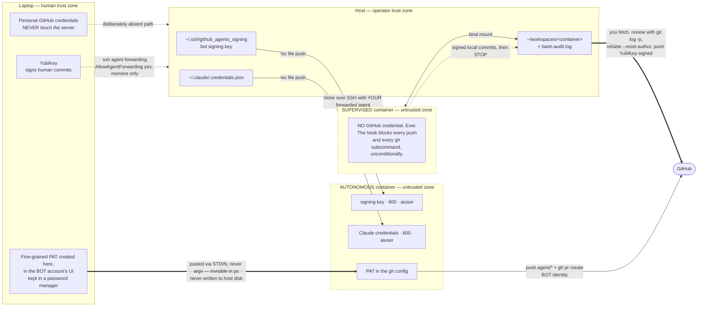
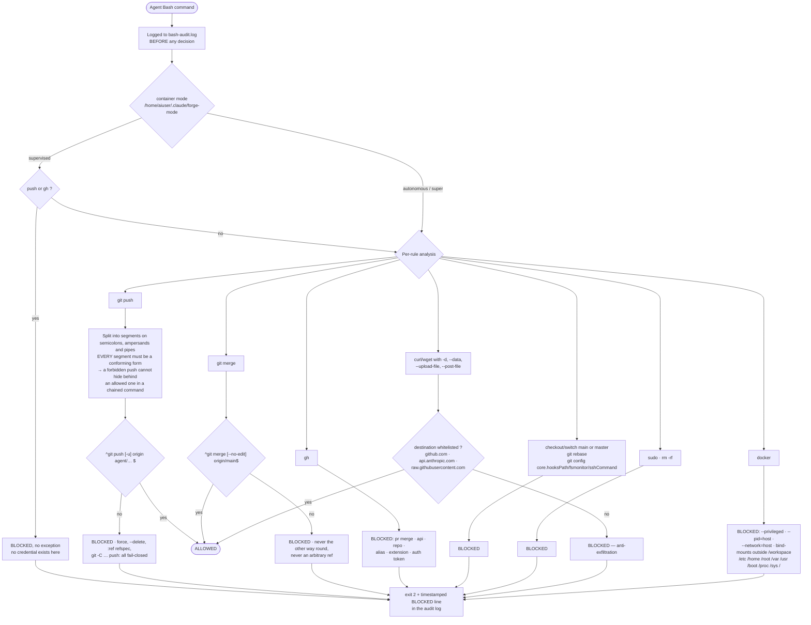
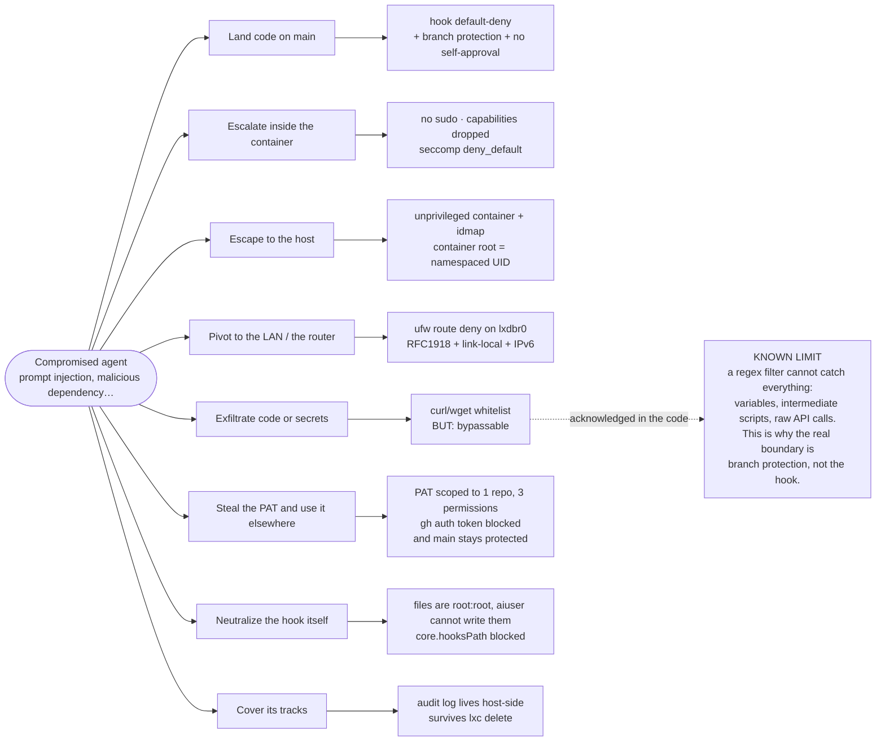

# agent-forge

Infrastructure for running Claude Code agents in isolated LXD containers on a dedicated Ubuntu server.

## Architecture

```
SSH (port 2222, Ed25519, no password)
└── UFW (deny all, allow 2222, LXD isolated from LAN)
    └── Fail2ban (5 retries, 30 day ban)
        └── LXD container (8 CPU, 12GB RAM, 100GB disk)
            └── aiuser (no sudo, /workspace only)
                └── Claude Code (Claude Pro, full permissions)
```

## Security model

The layered summary above is the short version. What follows is the full model:
what each layer stops, where every secret lives, and — just as important —
where the model deliberately stops making promises.

### Defense in depth

Five layers, each one assuming the previous has already fallen.

```mermaid
flowchart TB
  ATT(["External attacker"]) --> L1

  subgraph L1["Layer 1 — Host network perimeter"]
    direction TB
    A1["UFW: default deny incoming<br/>one open port: 2222/tcp"]
    A2["sshd: publickey ONLY<br/>AllowUsers moroine · PasswordAuthentication no<br/>TCP/StreamLocal forwarding off · LoginGraceTime 30s · MaxStartups 3:50:10"]
    A3["Fail2ban: sshd aggressive filter<br/>5 failures / 1h → 30-day ban, all ports"]
    A1 --> A2 --> A3
  end

  L1 -->|"host account compromised"| L2

  subgraph L2["Layer 2 — Container network segmentation"]
    direction TB
    B1["ufw route deny in on lxdbr0 → RFC1918<br/>10/8 · 172.16/12 · 192.168/16"]
    B2["+ link-local 169.254/16 · CGNAT 100.64/10 · multicast 224/4"]
    B3["+ IPv6: ULA fc00::/7 · link-local fe80::/10 · multicast ff00::/8"]
    B4["ufw route allow → internet only<br/>GitHub, Anthropic API"]
    B1 --> B2 --> B3 --> B4
  end

  L2 -->|"agent compromised inside a container"| L3

  subgraph L3["Layer 3 — LXD container isolation · agent profile"]
    direction TB
    C1["security.privileged = false<br/>container root = namespaced UID, no power on the host"]
    C2["security.syscalls.deny_default = true<br/>seccomp blocklist: mount, pivot_root, CLONE_NEWUSER, keyctl…"]
    C3["19 capabilities dropped<br/>sys_module · sys_rawio · sys_boot · sys_ptrace · mac_admin ·<br/>mac_override · bpf · perfmon · audit_* · syslog · ipc_* …"]
    C4["raw.idmap 1000 ⇄ 1001<br/>the container only ever sees its own mounted /workspace"]
    C1 --> C2 --> C3 --> C4
  end

  L3 -->|"agent turns malicious WITHIN its own perimeter"| L4

  subgraph L4["Layer 4 — The agent process"]
    direction TB
    D1["aiuser: no sudo, scoped to /workspace"]
    D2["pre-bash.sh hook on EVERY Bash call<br/>pushed root:root 755 → aiuser cannot rewrite it<br/>settings.json root:root 644"]
    D3["audit log /workspace/.claude/bash-audit.log<br/>written host-side: survives container deletion"]
    D4["rootless Docker: daemon runs as aiuser<br/>a Docker escape lands back at… aiuser"]
    D1 --> D2 --> D3 --> D4
  end

  L4 -->|"the regex filter is bypassable — it says so itself"| L5

  subgraph L5["Layer 5 — The REAL boundary, on GitHub"]
    direction TB
    E1["Branch protection on main<br/>PR required + 1 approval"]
    E2["Fine-grained PAT scoped to ONE repo<br/>Contents RW · Pull requests RW · Metadata R"]
    E3["GitHub forbids approving your own PR<br/>→ the bot can never merge its own work,<br/>even with a stolen token"]
    E1 --> E2 --> E3
  end
```



### Trust boundaries: where each secret lives

The design goal is that your personal credentials never exist on the server,
and that a container holds the smallest credential that still lets it do its
job — or, in supervised mode, none at all.



### The `pre-bash.sh` hook: a default-deny policy

Every Bash command the agent runs goes through this hook first. It is logged
before any decision is taken, so a blocked attempt is as visible as a
successful one.



### Attack paths and what stops them



### What this model does *not* promise

Three honest caveats, all of them deliberate design choices rather than
oversights:

- **`pre-bash.sh` is defense in depth, not a boundary.** Its own comments say
  so: a regex filter cannot catch a push hidden behind a variable, an
  intermediate script or a raw `curl` to the API. It raises the cost of a
  mistake and makes one visible in the audit log; the thing that actually
  keeps bad code off `main` is branch protection plus GitHub's refusal to let
  an account approve its own PR.
- **Supervised mode is the only one that removes the credential-theft class
  entirely.** There is nothing to steal: the clone happens host-side with your
  forwarded agent, and both `git push` and `gh` are blocked unconditionally.
  Autonomous mode trades that for automation, and bounds the damage with a
  PAT scoped to one repo and three permissions.
- **Super mode deliberately weakens layer 3.** The `agent-super` profile
  restores `mac_admin`, `mac_override` and `sys_ptrace`, which snapd needs to
  run the nested LXD. `security.privileged` stays `false` and the seccomp
  blocklist stays on, but it is the only profile that hands capabilities back
  — keep it for self-hosting agent-forge, not for general work.

## Prerequisites

- Ubuntu 24.04 fresh install
- SSH access (keyboard/screen) for initial setup
- Claude Pro account
- GitHub bot account, invited as a **write collaborator** on each target repo
- Node.js 24+ on the host (the `forge` CLI is TypeScript, run directly by Node's
  type stripping — no build step, no `npm install`). Node is separately installed
  *inside* the agent image; this entry is about the host. No `jq` needed on the
  host either — the CLI parses `lxc list -f json` in-process instead of shelling
  out to it.

## Setup

### 1. SSH

Install and generate host keys:

```bash
sudo apt update && sudo apt install -y openssh-server
sudo ssh-keygen -A
```

Copy `config/sshd_config` to `/etc/ssh/sshd_config`, then validate and restart:

```bash
sudo sshd -t
sudo systemctl restart ssh
```

### 2. Firewall

```bash
sudo apt install -y ufw

# Détecter l'interface sortante (wlo1 pour WiFi, eth0/enp3s0 pour filaire)
IFACE=$(ip route get 8.8.8.8 | awk '{print $5; exit}')

sudo ufw default deny incoming
sudo ufw default allow outgoing
sudo ufw allow 2222/tcp comment "SSH"

# Bloquer les containers LXD depuis toutes les plages privées/spéciales (IPv4)
# Empêche un container compromis d'atteindre le LAN ou des services internes
sudo ufw route deny in on lxdbr0 out on "$IFACE" to 10.0.0.0/8      comment "Block RFC1918 10/8"
sudo ufw route deny in on lxdbr0 out on "$IFACE" to 172.16.0.0/12   comment "Block RFC1918 172.16/12"
sudo ufw route deny in on lxdbr0 out on "$IFACE" to 192.168.0.0/16  comment "Block RFC1918 192.168/16"
sudo ufw route deny in on lxdbr0 out on "$IFACE" to 169.254.0.0/16  comment "Block link-local"
sudo ufw route deny in on lxdbr0 out on "$IFACE" to 100.64.0.0/10   comment "Block CGNAT"
sudo ufw route deny in on lxdbr0 out on "$IFACE" to 224.0.0.0/4     comment "Block multicast"

# Bloquer les plages privées IPv6 (le bridge lxdbr0 a IPv6 NAT activé par défaut)
sudo ufw route deny in on lxdbr0 out on "$IFACE" to fc00::/7        comment "Block IPv6 ULA"
sudo ufw route deny in on lxdbr0 out on "$IFACE" to fe80::/10       comment "Block IPv6 link-local"
sudo ufw route deny in on lxdbr0 out on "$IFACE" to ff00::/8        comment "Block IPv6 multicast"

# Autoriser internet (GitHub, Anthropic API, etc.)
sudo ufw route allow in on lxdbr0 out on "$IFACE" to any            comment "Allow internet"

sudo ufw enable
```

Optionnel — désactiver IPv6 sur le bridge LXD pour éliminer toute surface d'attaque IPv6 :

```bash
lxc network set lxdbr0 ipv6.address none
lxc network set lxdbr0 ipv6.nat false
```

### 3. Fail2ban

```bash
sudo apt install -y fail2ban
sudo cp config/jail.local /etc/fail2ban/jail.local
sudo systemctl enable --now fail2ban
```

### 4. System

Disable sleep and switch to headless mode:

```bash
sudo systemctl mask sleep.target suspend.target hibernate.target hybrid-sleep.target
sudo systemctl set-default multi-user.target
sudo reboot
```

### 5. LXD

```bash
sudo snap install lxd
sudo lxd init --minimal
sudo usermod -aG lxd $USER
newgrp lxd
```

Build the base image:

```bash
./scripts/forge image build
```

(Aliased as `forge image update` — same command, use whichever name you find
more intuitive for a rebuild.) This scripts the same steps every time:
launches a scratch `agent-base-setup` container, installs Node LTS, `pnpm`,
Claude Code, `gh`, `git`/`git-lfs`, Chrome, `chrome-devtools-mcp`,
and Docker (rootless) and Compose, creates `aiuser`, sets
up `/workspace`/`.ssh`/`.claude` ownership, then publishes the `agent-base`
alias and cleans up the scratch container. Only affects containers created
*after* the rebuild — already-running containers keep their existing image
until you delete and `forge start` them again. Safely re-runnable: a leftover
`agent-base-setup` from a previous failed build is deleted first.

Also stamps the image with the build's commit
(`lxc image set-property agent-base user.forge.commit <sha>`), which is how
`forge start` (at provisioning) and `forge list` (on every run) can tell a
container's image apart from whatever the latest build is — see
"Image versioning" below. There's no auto-rebuild trigger: you decide when
to run `forge image build` (e.g. after changing `scripts/lib/forge-image.sh`
or the container-side templates it installs), and it only affects containers
created afterward.

> **Note:** if you built `agent-base` before `gh` was part of the build, rebuild it — autonomous containers need the GitHub CLI.

To build the layered `agent-base-super` image (base + nested LXD, for super
mode), run `forge image build super` — but create and configure the
`agent-super` profile first (see "Super mode" below).

Create the agent LXD profile:

```bash
lxc profile create agent
lxc profile edit agent
```

Paste the content of `config/lxd-agent-profile.yaml`.

This enables `security.nesting` (needed for rootless Docker inside each
container — see "Docker/Compose access" below) on top of an otherwise
unprivileged container, and sizes the root disk at 100GB to leave room for
Docker images/volumes.

### 6. GitHub bot account: signing key, PAT, branch protection

#### Signing key

Generate the commit-signing key on the server:

```bash
ssh-keygen -t ed25519 -C "agents-server-signing@github" -f ~/.ssh/github_agents_signing -N ""
```

On the GitHub bot account, add `github_agents_signing.pub` as a **Signing Key** under Settings → SSH and GPG keys. Agent commits then show as **Verified**.

> The old read-only deploy key (`~/.ssh/github_agents`) is no longer used by
> either mode — autonomous containers authenticate with a PAT over HTTPS,
> and supervised containers get no credential at all (the host clones over
> SSH using your own forwarded agent instead; see §7 and "Supervised mode"
> below). It can be removed if you don't need it for anything else.

#### Fine-grained PAT (one per target repo)

Created from **your laptop**, in the **bot account's** web UI — your personal
credentials never touch the server or the containers. GitHub has no API to
mint fine-grained PATs, so this step is manual:

1. Invite the bot account as a collaborator with **write** access on the target repo (and accept the invitation as the bot).
2. Logged in as the bot: Settings → Developer settings → Personal access tokens → Fine-grained tokens → Generate new token.
3. Resource owner: the repo's owner. Repository access: **Only select repositories** → the target repo.
4. Permissions: **Contents: Read and write**, **Pull requests: Read and write**, **Metadata: Read** (added automatically).
5. Expiration: maximum (1 year).
6. Keep the token in your password manager; you'll paste it when creating the container.

> **Fallback:** fine-grained PATs targeting a repo owned by another account
> are recent on GitHub's side. If token creation or usage fails cross-owner,
> use a classic PAT (`repo` scope) on the bot instead — same effective
> boundary, since the bot is only invited to agent-approved repos.

#### Branch protection (required before the first autonomous container)

On each autonomous repo, protect `main`: Settings → Branches → Add branch
ruleset (or classic protection rule) on `main`, with **Require a pull request
before merging** and **Require approvals: 1**.

This is the real security boundary — even a leaked token cannot land code on
`main`, and since GitHub forbids approving your own PR, the bot can never
merge its own work. You review and approve as yourself.

### 7. SSH Agent Forwarding (YubiKey)

On the server, add to `sshd_config`:

```
Match User moroine
    AllowAgentForwarding yes
Match User *
    AllowAgentForwarding no
```

On your local machine, add to `~/.ssh/config`:

```
Host omen
  HostName 192.168.1.177
  Port 2222
  User moroine
  ForwardAgent yes
```

Configuration de git host

```
git config --global user.name "Ton Nom"
git config --global user.email "ton@email.com"
git config --global gpg.format ssh
git config --global user.signingkey "$(ssh-add -L | head -1)"
git config --global commit.gpgsign true
```

## Usage

### Mental model: one container per repo, one worktree per task

A container maps to a **repo**, not to a single task. `/workspace` inside the
container is a normal clone, always checked out on `main` — nothing ever
commits there. Each feature lives in its own **git worktree** under
`/workspace/.trees/<task>`, checked out on its own `agent/<task>` branch, with
its own tmux session named after the task and its own `claude` process
attached inside it. That lets you run several features in parallel on the
same container/repo — no cross-task interference, and no waiting for one
task to finish before starting the next. All worktrees share the same
`.git` (branches, remotes, LFS objects), so retrieval, review and pushes all
see the same object store.

### Start a container and a task (creates the container on first use)

```bash
./scripts/forge start [<owner/repo>] [<task>]
```

Container identity is derived from `owner/repo` — no project name to choose
or remember. If no container exists yet for that repo, `forge start`
provisions one first:
- Prompts for the container's mode: **autonomous** (bot pushes and opens PRs itself) or **supervised** (no GitHub credential ever touches the container — see "Supervised mode" below)
- Creates an LXD container from `agent-base`
- Mounts `/workspace` with correct permissions (no `sudo` required — LXD idmap shifting handles the UID mapping, scoped to that one mount)
- Copies the signing key and configures git (signed commits)
- Reuses your Claude Code credentials from the host (`~/.claude/.credentials.json`), so the container starts already authenticated — no Remote Control pairing needed
- Pre-accepts onboarding and installs the `superpowers` plugin, so the first `claude` launch skips the setup questions
- **Autonomous:** prompts for the bot's fine-grained PAT (see setup §6), authenticates `gh` inside the container — the token is never written to host disk — and clones `https://github.com/<owner/repo>.git` into `/workspace` inside the container
- **Supervised:** no token prompt; clones `git@github.com:<owner/repo>.git` on the host over SSH, using your own forwarded agent (§7) — the container never receives any GitHub credential
- Either clone step is **skipped when `~/workspaces/<container>` already holds a clone of that same repo** — a workspace left behind by a previously deleted container is adopted as-is, with only its `origin` URL realigned on the new container's mode (see "Re-provisioning over an existing workspace" below)
- Sets up `git-lfs` (which itself ships preinstalled in the `agent-base` image, via `forge image build`) in three separate steps, because they don't have the same reliability: **the LFS filters** (`git lfs install --skip-repo` — clean/smudge/process in the global config, so LFS files check out and commit normally) and **`.trees/` in `.git/info/exclude`** (so worktrees never show up as untracked noise in `/workspace`) are both required and abort provisioning if they fail; **the repo's LFS hooks** (`git lfs install` in `/workspace`) are best-effort. `git lfs install` refuses to overwrite a `pre-push` hook it doesn't recognise and exits 2 — which happens whenever the project manages its own hooks (husky sets `core.hooksPath`, and git-lfs then installs *into* it) or the hooks present were written by a different `git-lfs` version than the image's. Since a surviving workspace is adopted rather than recloned, both are normal inputs, and neither is a reason to leave a half-provisioned container behind: the failure and git's own message are printed on stderr, along with `git lfs update --manual` as the manual way out, and provisioning carries on. Only the pre-push *upload* hook is missing in that case
- Stamps the container with the commit `forge image build` last ran from (`user.forge.image_commit`), so `forge list` can later tell you if it's running an older image than the latest build
- Records `owner/repo` and mode on the container itself (LXD config keys) — there's no separate registry file; `forge list` and future `forge start` calls discover containers this way

Either way (freshly provisioned or already existing), `forge start` then
starts the container if it's stopped, and:
1. **Refreshes `main`** — autonomous containers `git fetch origin` in `/workspace` first, so every new task branches from a genuinely current `origin/main` (that remote-tracking ref, not the local `main`, is what the worktree is cut from); supervised containers have no credential to fetch with, so this step is skipped and the task branches from whatever `origin/main` was last fetched to (fetch it yourself on the host beforehand if you need it current — see "Supervised mode" below). The local `main` ref is then fast-forwarded too, as a convenience for anyone reading `/workspace` directly — by `git fetch origin main:main` when `main` isn't the branch checked out there, and by `git merge --ff-only origin/main` when it is. **The branch checked out in `/workspace` is never merged into**: the main clone is *meant* to sit on `main`, but when it has drifted onto some `agent/*` branch, advancing that branch is not something `forge start` was asked to do. Neither step is fatal: a failure (host offline, origin unreachable, a local `main` that has diverged) prints git's own message on stderr and `forge start` carries on. The two are reported separately, because they have different consequences — a failed *fetch* means the task may branch from a stale `origin/main`; a failed *fast-forward* means only `/workspace`'s own `main` lags, while the task still branches from a current `origin/main`.
2. **Puts the task's worktree in place** — resolving what `<task>` should branch from rather than always starting over from `main` (see "Resolving the task's branch" below).
3. **Attaches the session** — starts (or re-attaches, via `tmux new-session -A`) a tmux session named `<task>`, `cd`'d into `.trees/<task>`, running `claude` in `auto` permission mode (`--permission-mode auto`) — autonomous by default, but the auto-mode classifier pauses for confirmation on sensitive actions (credential handling, irreversible deletion, pushes to protected branches, etc.). A session URL and QR code are displayed at startup.

Running `forge start` again with a *different* task name on a repo that
already has a container just adds another worktree — no re-provisioning, no
re-pasting the PAT.

#### Resolving the task's branch

`forge start` is idempotent: given a task whose worktree is already there, it
attaches to it instead of failing. Otherwise it picks the branch to work from
in this order, announcing which case it landed in so you always know what
you're sitting on:

| Situation | What happens |
|-----------|--------------|
| `.trees/<task>` already exists | Attach to it (same thing `forge resume` does) |
| A ref was named through the `other branch…` menu entry | New `agent/<task>` branched from that ref |
| Local `agent/<task>` exists | Worktree on that branch — the case left behind by `forge finish`, which keeps the ref |
| `origin/agent/<task>` exists | New local `agent/<task>` tracking it — a branch pushed from another container or machine, typically an open PR |
| Nothing exists | New `agent/<task>` from `origin/main` |

Leave `<task>` out and you get these as a menu instead — existing worktrees,
`agent/*` branches that have no worktree (local, or only on `origin`), plus
`new task` and `other branch…`:

```
$ forge start moroine/agent-forge
 1) new task
 2) cli (existing worktree — attach)
 3) docs (local branch)
 4) api (branch on origin)
 5) other branch…
Task>
```

`other branch…` asks for a ref and a task name, and is how you pick up a
branch that doesn't follow the `agent/<task>` convention — say a
`feature/*` branch a human pushed. The work still happens on `agent/<task>`
branched from it, never on the original branch: the container's `pre-bash.sh`
hook only lets the agent push to `origin agent/*`, so a worktree on any other
branch could commit but never publish. The trade-off is that you get a fresh
PR rather than adding commits to the existing one.

### Resume or finish a task

```bash
./scripts/forge resume [<owner/repo>] [<task>]   # re-attach an existing task's tmux session
./scripts/forge finish [<owner/repo>] [<task>] [--force]   # remove a finished task's worktree
```

Leave a bracketed argument out and `forge` asks for it as a numbered menu,
built from the containers and worktrees that actually exist — the same
source the bash completion reads. With no terminal on stdin (a script, CI)
nothing is asked: the command prints its usage and exits non-zero rather
than blocking on a prompt nobody will answer.

`forge resume` does no fetch and no rebranch — it just starts the container
if needed and re-attaches the task's existing tmux session. It errors out
(pointing you at `forge start`) if the worktree doesn't exist.

`forge finish` runs the same dirty-tree/unpushed-commits WIP check as `forge
stop`/`forge delete` (scoped to that one worktree) unless `--force` is
passed, then runs `git worktree remove` and kills the task's tmux session if
it's still around. The `agent/<task>` branch itself is **not** deleted — it
stays in the shared `.git`, so a merged or abandoned task can still be
inspected or re-checked-out later.

### Working on several features in parallel

Because worktrees are independent, nothing stops you from having multiple
tasks in flight on the same repo/container at once:

```bash
./scripts/forge start <owner/repo> feature-a
./scripts/forge start <owner/repo> feature-b   # second worktree, second tmux session
```

Each gets its own `.trees/<task>` checkout, its own `agent/<task>` branch,
and its own tmux session — detach from one (`Ctrl+b d`) and `forge resume`
the other, or check `forge list` to see which sessions are attached.

### Autonomous PR flow

The agent works on `agent/<task>` inside its worktree, pushes with
`git push -u origin agent/<task>` and opens a PR with
`gh pr create --base main`, all authenticated as the bot. The `pre-bash.sh`
hook only allows pushes to `origin agent/*` (no force, no delete) and blocks
`gh pr merge`, `gh api`, `gh repo`, `gh alias`, `gh extension` and
`gh auth token`. You review, approve and merge the PR as yourself.

### Supervised mode

For repos where no standing GitHub credential should ever exist inside a
container. The container gets no PAT and no `gh auth` — `pre-bash.sh`
blocks every `git push` and every `gh` subcommand unconditionally, and
`templates/CLAUDE.md` tells the agent to commit locally (signed) and stop
when the task is done, never attempting to publish.

Retrieving and publishing the work is a manual, laptop-side flow — every
line the agent wrote gets reviewed before it's re-authored as your own:

```bash
git remote add <container> ssh://moroine@<host>:2222/home/moroine/workspaces/<container>
git fetch <container> agent/<task>:agent/<task>
git log -p main..agent/<task>          # review before doing anything else
git checkout agent/<task>
git rebase --reset-author main
git push origin agent/<task>            # your identity, YubiKey-signed
```

`forge start`'s supervised path prints the exact `git remote add` command
(container name filled in) at the end of provisioning. Since every worktree
lives in the same clone's `.git`, this one `git remote add` gives you access
to every task's branch on that container, not just one.

Because supervised containers never fetch (no credential), `forge start` on
a supervised container branches each new task from whatever `origin/main`
was last fetched to — which may be stale. If you want a task to start from a
genuinely current `main`, fetch it yourself from a host shell in the
workspace directory (`git -C /home/moroine/workspaces/<container> fetch
origin`) before running `forge start`.

### Super mode

For self-hosting agent-forge itself: a super container is an **autonomous
container plus a nested LXD**, so an agent can run `forge`, `lxc`, and the real
integration tests (`FORGE_INTEGRATION=1 npm run test:integration`) against a
live LXD fully isolated from the host's. Git discipline is identical to
autonomous mode (push `agent/*`, open a PR, human merges).

Setup (once), in order — the profile must exist before the image, because the
build container itself needs its capabilities:

```bash
lxc profile create agent-super
lxc profile edit agent-super   # paste config/lxd-agent-super-profile.yaml
./scripts/forge image build super
```

`agent-super` is `agent` with three capabilities restored
(`mac_admin`, `mac_override`, `sys_ptrace`) that the nested LXD's snapd needs;
`security.privileged` stays `false` and the seccomp blocklist stays on. The
nested LXD (`agent-base-super` image) cannot see the host's LXD — the agent's
`lxc` only drives its own nested daemon.

Pick super at `forge start` (the `[u]` choice). Everything else — PAT prompt,
`gh auth`, HTTPS clone, PR flow — is the autonomous path.

### Docker/Compose access

Every agent container gets rootless Docker and Compose by default (baked
into `agent-base`, no opt-in) — for repos that need a backing service
(MongoDB, Postgres, Redis, ...) for tests or for running the app itself.
The daemon runs entirely as `aiuser` (no root, no `docker` group, no
privileged daemon): a worst-case container escape lands the agent back at
its own existing `aiuser` privilege level, nothing new. `pre-bash.sh` blocks
`--privileged`, `--pid=host`/`--network=host`, and bind-mounts outside
`/workspace` as defense-in-depth on top of that containment — everything
else (`docker run`, `docker compose up`, named volumes, workspace-relative
bind mounts) works normally. See
`docs/superpowers/specs/2026-07-17-agent-docker-support-design.md` for the
full design rationale.

### Browser automation (Chrome DevTools MCP)

Every agent container gets `chrome-devtools-mcp` wired up globally as an MCP
server — no `.mcp.json` needed per repo. It drives the headless
`google-chrome-stable` already installed in the image, letting the agent
navigate to a locally running dev server, take screenshots, and read
console/network output — the tool needed to follow the "verify UI changes in
a browser before reporting done" guidance in a container with no display and
no `claude-in-chrome` extension pairing.

Only reaches *new* containers: the binary is baked into the image at `forge
image build` time, and the MCP server declaration is pushed to
`~/.claude.json` once, at initial provisioning — neither refreshes on an
already-existing container. Rebuild the image and recreate (`forge delete`
+ `forge start`) to pick it up on a container that predates this change.

### Token renewal

Fine-grained PATs expire (max 1 year). To renew: create a new PAT in the bot's
web UI (same repo, same permissions), then re-authenticate the affected
container:

```bash
read -r -s TOKEN && printf '%s' "$TOKEN" | lxc exec agent-<owner>-<repo> -- su - aiuser -c "gh auth login --hostname github.com --with-token"; unset TOKEN
```

(`read -r -s` keeps the token out of your shell history and off the terminal.)

### Remote access

Each task's session registers under `<container>-<task>` (e.g.
`agent-owner-repo-feature-a`), so multiple parallel tasks on the same repo
show up as distinct sessions. Once a session is running, connect from any
device:

- **Browser**: open the session URL printed at startup, or go to [claude.ai/code](https://claude.ai/code) and find the session by its `<container>-<task>` name
- **Mobile app**: tap **Code** in the Claude app navigation

The session stays accessible as long as the container is running and the `claude` process is alive in that task's tmux session. If the Remote Control connection times out (network outage >10 min), re-run `forge resume <owner/repo> <task>` to re-attach (`forge start` on that task does the same thing) — or type `/remote-control` inside an existing session to re-enable it.

**Requirements**: the host must be authenticated with a claude.ai account (`claude auth login`). API key auth does not support Remote Control. New containers reuse this credential automatically at provisioning time (see "Start a container and a task" above); if you re-authenticate on the host afterward, existing containers keep their own copy until recreated.

### tmux cheatsheet

| Action | Command |
|--------|---------|
| Detach | `Ctrl+b d` |
| Reattach | `./scripts/forge resume <owner/repo> <task>` |
| List sessions | `./scripts/forge list` |
| Kill session | `lxc exec agent-<owner>-<repo> -- su - aiuser -c "tmux kill-session -t <task>"` |

### Stop / list / delete containers

```bash
./scripts/forge stop [<owner/repo>] [--force]    # stops the whole container; refuses if any worktree has dirty/unpushed WIP unless --force
./scripts/forge list                             # every container (repo, mode, LXD state, image build status) plus one row per task worktree (session attached/detached)
./scripts/forge delete [<owner/repo>] [--force]  # refuses on dirty/unpushed WIP in any worktree unless --force (skipped if already stopped)
```

`forge stop`/`forge delete` operate on the whole container, not a single
task — they run the WIP check across every `.trees/*` worktree (via the same
check `forge finish` runs on one worktree). To wind down a single task
without touching the others, use `forge finish` instead.

`forge list` prints one row per container followed by an indented row per
feature worktree that container currently has checked out:

```
REPO             MODE        STATE    BUILD
owner/repo       autonomous  Running  ok
  feature-a      attached
  feature-b      detached
  feature-c      no session
owner/other      supervised  Stopped  behind
```

Column widths are computed from the data, so a long repo name widens its
column instead of shifting every column after it. Two columns are
deliberately absent because they are derivable and only made the output
wrap: the container name (always `agent-` plus the sanitized repo) and a
task's branch (always `agent/<task>`).

The `BUILD` column compares the container's stamped image commit against the
latest `forge image build` (see "Image versioning" below): `ok` if they
match, `behind` if the container runs an image older than latest build,
`unknown` if either commit is unavailable (e.g. `agent-base` was never
stamped). Worktree rows only show for running containers;
`attached`/`detached` reflects whether the task's tmux session currently has
a client attached, and `no session` means the worktree exists but its tmux
session isn't running.

### Image versioning

`forge image build` stamps the published `agent-base` image with the
agent-forge commit it was built from (`lxc image set-property agent-base
user.forge.commit <sha>`). Every `forge start` that provisions a *new*
container copies that stamp onto the container (`user.forge.image_commit`),
so the two can be compared later even after you've rebuilt the image several
times.

There's no automatic rebuild or in-place patch: a container keeps running
whatever image it was created from until you explicitly recreate it. When
`forge list` reports a container as `behind` (running an image **older than
latest build**), that's informational, not an error — you decide whether the
drift matters enough to act on it. If you do, recreate the container to pick
up the newer image:

```bash
./scripts/forge delete <owner/repo> --force   # or without --force if WIP is already clean
./scripts/forge start <owner/repo> <task>
```

This re-provisions from scratch (new PAT prompt for autonomous containers)
and re-creates the worktree for `<task>` — any other worktrees that existed
only in the deleted container are gone with it, so finish or retrieve them
first. The clone itself is *not* redone: `forge delete` only removes the
container, and `~/workspaces/<container>` — which in supervised mode is the
only copy of any work you haven't retrieved yet — survives on the host, so
the new container adopts it (see "Re-provisioning over an existing
workspace" below).

### Re-provisioning over an existing workspace

`forge delete` removes the container only. `~/workspaces/<container>` is a
host directory bind-mounted into it, and it deliberately outlives the
container — in supervised mode it is the **sole** copy of any commit you
haven't retrieved yet. Provisioning therefore never clones over it blindly.
Before creating anything (no container, no mount, no PAT prompt), it looks at
that directory:

| State of `~/workspaces/<container>` | What provisioning does |
| --- | --- |
| Missing, or empty | Clones normally |
| A clone of the same `owner/repo` | Adopts it — no clone — and runs `git remote set-url origin` to match the new container's mode (`git@github.com:…` supervised, `https://github.com/…` autonomous) |
| Anything else, non-empty | Stops with an error, having touched neither the directory nor the host |

The adopted clone keeps its branches and its `.trees/` worktrees, so a
container recreated to pick up a newer image comes back with its history
intact. To genuinely start from a fresh clone, move or remove the directory
yourself first — that deletion is yours to make, never the tool's:

```bash
mv ~/workspaces/<container> ~/workspaces/<container>.old   # review, then remove
```

### Bash completion

Completion is registered for the bare command name `forge`, not a path — if
you invoke the CLI as `./scripts/forge` (this README's convention),
tab-completion won't trigger unless `forge` also resolves on your `PATH`.
Add an alias alongside the `eval` line so both work the same way:

```bash
alias forge=/home/moroine/agent-forge/scripts/forge
eval "$(/home/moroine/agent-forge/scripts/forge completion bash)"
```

**Use the full path in the `eval`, not the alias.** That line has to run
`forge` at the moment `~/.bashrc` reaches it, and an alias defined on a later
line — or a `PATH` entry added further down — is not available yet. When it
cannot run, `$(...)` is empty, `eval ""` defines nothing, and completion falls
back to filenames with no error to explain why. `type _forge_completions`
returning "not found" is the symptom.

The emitted function itself calls `forge` by absolute path, so it keeps
working regardless of how `forge` is resolved in your shell.

Add those two lines to `~/.bashrc` to get tab-completion on `forge
start`/`resume`/`finish`/`stop`/`delete`: `<owner/repo>` in second position,
then the repo's task names on `start`/`resume`/`finish` and `--force` on
`stop`/`delete`/`finish`.

The completion is fed by two machine-readable subcommands rather than by
parsing the `forge list` table, so reformatting the table can't break it:

```bash
forge completion repos               # one owner/repo per line
forge completion tasks <owner/repo>  # one task name per line
```

`completion repos` only reads LXD config keys (no `lxc exec`), which is what
keeps a TAB press fast. `completion tasks` needs the container running — a
stopped container simply lists nothing.

### Developing the CLI

The CLI lives in `scripts/forge.ts` and `scripts/lib/`, written in TypeScript
and executed directly by Node — there is no build step and no runtime
dependency, which is why the host needs nothing but Node itself.

```bash
npm install          # development only: typescript + @types/node
npm test             # unit + contract (real git/tmux) + the retained bash tests
npm run check        # tsc --noEmit — Node strips types without checking them
```

`npm run check` is not optional in spirit: Node erases type annotations without
verifying them, so `tsc` is what makes the types mean anything.

Two things stay in bash on purpose: `scripts/lib/forge-image.sh`, which is a
sequence of provisioning shell piped into a container (in TypeScript it would
just become template strings of the same shell, with no readability gain),
and `.claude/hooks/pre-bash.sh`, a container-side security control that must
stay auditable and independent of the container's Node install.

A third test layer runs against a real LXD and is opt-in, because it needs
the host:

```bash
FORGE_INTEGRATION=1 npm run test:integration
```

It creates a throwaway container inside a dedicated `forge-selftest` LXD
project — instances in another project never appear in `forge list` — and
deletes it again. Its `--capture` mode refreshes `tests/fixtures/`, which is
what keeps the faked `lxc` in the other layers honest.
