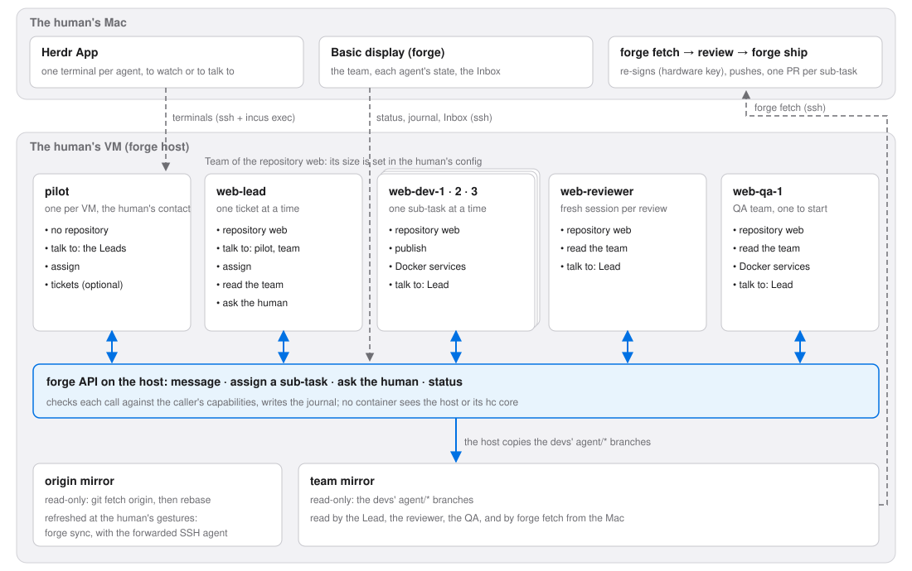

# DX 5: agent teams under herdr-core — Design

**Date:** 2026-11-11
**Status:** Approved by the maintainer (2026-11-11), after a brainstorm and an
independent review the same day
**Branch:** `agent/dx-5-design`, from `main` (pull request `--base main`)
**Issues:** moroine/agent-forge#92 (DX 5), moroine/agent-forge#19 (Docker
services per task)
**Inputs:** the herdr-core spike report (moroine/agent-forge#144,
`docs/superpowers/spikes/2026-11-11-herdr-core.md`), and the needs of the
first Herdr App template, written by a collaborator of the maintainer
(summarized in §5.10; not in the repository)

## 1. Intent

forge v2 runs one agent per task, and the human drives each agent by hand,
in the herdr TUI. DX 5 turns that into a **team of agents that works like a
development team**:

- a **Pilot**, the human's only contact, like a CTO;
- one **Lead** per GitHub repository, who splits a request into sub-tasks and
  runs the team;
- several **developers**, who each work on one sub-task at a time;
- a **reviewer** and a **QA**.

Every agent runs in its own container on the human's VM. Agents talk to each
other only through a narrow API on the host. The human keeps the only path to
GitHub: `forge fetch`, review, then `forge ship`, which re-signs, pushes and
opens one pull request per sub-task.

**Why now.** This is the critical path of the POC milestone: prove that a team
develops with agents securely, with real project management. A collaborator
writes a template for **Herdr App** (the desktop app built on herdr-core) that
plugs a ticket manager into this team. The demo is wanted as soon as possible;
the design iterates after.

**Open source.** forge must run the whole loop **without any ticket manager
and without the template**: a request given to the Pilot, split by the Lead,
built by the developers, reviewed, and shipped. It ships a basic display and
a reference team for that. Without them, the open-source brick would be an
empty shell.

**Success.** On a real host, with Herdr App on the maintainer's Mac: the human
gives a request to the Pilot; the Lead splits it and assigns sub-tasks; two or
three developers work in parallel in their containers, each with its own
Docker services; the reviewer and the QA read their branches; a question the
Lead cannot settle reaches the human's Inbox; the human runs `forge fetch`,
reviews, and `forge ship`s one pull request per sub-task.

## 2. The model



### 2.1 Words

- **Human**: the person at the Mac, in Herdr App. Each human has their own VM
  (one human per VM for now; several later, moroine/agent-forge#135).
- **Agent**: a Claude Code session running in a container.
- **Container**: an Incus container on the human's VM. One agent per
  container, one task at a time per container.
- **Team**: the containers of one human: one Pilot for the VM, and per
  repository a Lead, N developers, one reviewer and a QA team (one QA to
  start). The human declares it in their config; its size follows the VM's
  memory and CPU.
- **Capability**: a right forge gives a container (§5.2). A **role** is only a
  name on a set of capabilities.
- **Task**: a unit of work for one container. For a developer, a sub-task on
  a branch `agent/<sub-task>`; for a Lead, a ticket; for a reviewer, a review.
- **Session**: one agent conversation. The container lasts; the session
  starts fresh for each task.

### 2.2 The path of a request

1. The human gives a request to the Pilot, in the Pilot's terminal in Herdr
   App.
2. The Pilot passes it to the Lead of the repository (API: `assign`, which
   starts a fresh Lead session for this request). At that moment the human
   refreshes the origin mirror (`forge sync`, with their SSH agent).
3. The Lead splits the request and assigns a sub-task to each free developer
   (API: `assign`): a fresh session on `agent/<sub-task>`, from `origin/main`.
4. A developer who is stuck asks the Lead (API: `message`). If the Lead cannot
   settle it, it asks the human (API: `ask-human`); the question reaches the
   Inbox, and the human answers with `forge answer`.
5. The developer commits; the host copies its branch into the team mirror.
   The Lead asks the reviewer for a review, then the QA for a pass; both read
   the branch from the team mirror.
6. The human runs `forge fetch`, reviews, then `forge ship`: one pull request
   per sub-task.

## 3. Decisions made by the maintainer

1. **One container per agent.** No repository-wide container shared by
   several agents: agents would step on each other, could not work in
   parallel safely, and would share their secrets (the spike showed that every
   terminal of an hc core inherits its environment). The Pilot, the Lead, the
   reviewer and the QA have their own containers, like each developer.
2. **The team is human configuration.** One Pilot per VM, i.e. per human for
   now (shared pilots: later). One Lead per GitHub repository. A fixed number
   of developers and QAs, set by the human from the VM's capacity, rather than
   spawned on the fly: memory is the limit (a heavy Docker Compose stack per
   developer). "Recruiting" a developer is a forge command the human runs. No
   agent ever creates a container.
3. **Long-lived containers, fresh sessions.** A container keeps its clone and
   its Docker services from one task to the next. The agent in it starts a new
   session for each task. The Pilot keeps one long session; when its context
   fills up, it starts over and re-reads its notes (or, with a template, the
   ticket manager).
4. **One mode: the team.** The current single-agent usage (`forge start`, one
   container per repository with one worktree per task) goes. Using forge
   "solo" means a team with one developer, to whom the human talks directly.
   Two tasks in one container is the problem being removed.
5. **Capabilities, not roles.** forge defines a closed list of capabilities;
   a role is a named set of them. Only the human gives capabilities, in their
   config, when building the team. An agent can never request one through the
   API. The detailed communication policy (beyond capabilities) comes later.
6. **forge decides what an agent can do; the template decides what it should
   do.** forge owns isolation, capabilities, secrets per capability, network,
   resources, and the common rules. The template (or forge's reference team)
   owns role prompts, herdr-core templates, models, plugins, and the workflow.
7. **One pull request per developer sub-task.** Each sub-task starts from
   `origin/main`. Stacked pull requests are a known limitation for now. The
   Lead's prompt keeps dependent sub-tasks from running in parallel.
8. **The origin mirror is refreshed at the human's gestures** for the POC,
   with their forwarded SSH agent. A refresh without the human (which would
   need a new credential on the host) comes later.
9. **Git is no longer policed inside containers.** With no credential in a
   container and `origin` a read-only mirror, the git rules of
   `container/pre-bash.sh` (push, merge, rebase, branch switching…) protect
   nothing there. Control moves to the exits: only `agent/*` branches leave a
   container, and `forge ship` replays and signs them. The strict git rules
   stay where credentials are: the maintainer's machine (this repository's
   `.claude/settings.json`) and the contributor VM. Containers refresh against
   `main` by `git fetch origin` and `git rebase origin/main`.
10. **Everything moves to herdr-core and Herdr App.** The herdr TUI is dropped,
    with no period where both are supported.
11. **The open-source version runs the whole flow without a ticket manager**,
    with the Pilot as the single entry point. forge exposes a status API, an
    `ask-human` verb and an Inbox, a basic display, and a reference team.
12. **The basic display is a command plus a notification** (option C of the
    brainstorm): `forge team watch` in a Herdr App terminal, `forge answer` to
    answer, and a small Herdr App mod that notifies on a new question and opens
    the team view by a shortcut. A native Herdr App panel (option B) may follow
    if the mod API proves cheap to maintain.
13. **The container-to-host channel is a Unix socket per container**, through
    an Incus `proxy` device; the API identifies the caller by the socket the
    request came through; one JSON request, one JSON line back; a few fixed
    verbs, checked against capabilities and written to a journal. This changes
    the security architecture and was validated explicitly.
14. **Requests are validated by hand**, like the relay's
    (`cli/lib/relay/serve.ts`): forge keeps no runtime dependency. A
    well-maintained validation library may come later, for readability.
15. **Superpowers leaves the containers.** forge enables no plugin by default;
    each role declares its plugins in the team definition.
16. **Delivery in four parts** (§5.11), each merged before the next; the demo
    as soon as possible.
17. **One model family for now.** Codex, and the rule that a reviewer is of the
    other family, come later.

Settled after an independent review of this design:

18. **SSH connection sharing on the Mac.** `forge install` configures OpenSSH's
    `ControlMaster` and `ControlPersist` for the forge hosts: one touch of the
    hardware key opens a master connection that the Herdr App machines,
    `forge team watch`, the mod and a template's backend reuse. The duration is
    configurable, 8 hours by default. The trade-off is accepted: during that
    time, a program running under the human's account on the Mac can open
    sessions on the host without a touch. Signatures with the forwarded agent
    still ask for a touch each. A second, touchless key limited by a forced
    command (like the relay's) is a possible later replacement.
19. **Both terminals until DX 5 is done.** Part 1 removes the herdr TUI from
    the containers and the team. `forge open` and the contributor VM's
    launcher keep the TUI until DX 5 is delivered, so the maintainer keeps
    talking to the contributor agent that builds it. The dev VM moves to Herdr
    App in its own task, after the acceptance run. This amends decision 10.
20. **A `claude setup-token` token in every container**, instead of copying
    the host's `.credentials.json` (a refreshing OAuth login, whose refresh in
    one long-lived container might invalidate the other copies). The token is
    valid one year, limited to model requests, and revocable in claude.ai.
    It disables Claude Code's Remote Control in the containers; accepted.

## 4. Goals, non-goals, anti-goals

### Goals

- A team declared in config and built by one command, one container per
  agent, each container visible and reachable in Herdr App.
- The API between containers: `message`, `assign`, `release`, `ask-human`,
  `status`, with capabilities and a journal.
- The team mirror, so reviewers, QAs, Leads and `forge fetch` read the
  developers' branches from one place.
- forge entirely on herdr-core; the herdr TUI gone.
- A basic display and a reference team that run the flow of §2.2 with no
  ticket manager.
- What a template needs to plug in: a status API readable from the Mac, a
  secret and egress domains per capability, plugins and prompts per role.

### Non-goals (POC)

- Codex or a second model family.
- Stacked pull requests, or one pull request per ticket.
- An origin mirror refreshed without the human.
- Shared Pilots, several humans per VM (moroine/agent-forge#135).
- Agents that create containers or change capabilities.
- The single-agent "solo" mode.
- A native Herdr App panel.
- A communication policy finer than capabilities.
- Any knowledge of a specific ticket manager in forge.
- A preview of the running app for human QA (port forwarding); screenshots
  from headless Chrome are enough for the POC.
- A validation library.

### Anti-goals (would make this a failure even if it works)

- A container that reaches the host's hc core, `incus`, or another
  container's socket.
- A template, a role prompt or an agent that widens a right.
- A secret in an argv, in hc's state, in the journal or in a message.
- An API verb that runs free-form commands, or agent text interpolated into a
  shell line.
- forge naming or depending on a particular ticket manager.

## 5. Design

### 5.1 Overview

Three places (diagram in §2):

- **The Mac**: Herdr App, with one hc machine per container (§5.6); the basic
  display (`forge team watch`, `forge answer`) and the forge mod; `forge sync`,
  `forge fetch`, `forge ship`. Everything the Mac does on the host goes through
  the human's own SSH access.
- **The host**: the forge API (a long-running forge process, §5.4), the origin
  mirror and the team mirror of each repository (§5.5), the config that
  declares the teams.
- **The containers**: one agent each, an hc core run as `aiuser`, a socket to
  the API, and a small command `forge-team` that agents use to call it.

### 5.2 Containers, capabilities, roles

**The closed list of capabilities** (names are the builder's; the set is the
design):

| Capability | What it gives |
|---|---|
| `repo` | a clone of the repository, with `origin` as the read-only mirror; without it the container has no repository (the Pilot) |
| `publish` | the container's `agent/*` branches can leave: into the team mirror and to `forge fetch` |
| `read-team` | the team mirror, mounted read-only |
| `talk-to` | the list of containers it may send a `message` to |
| `assign` | it may `assign` tasks to the containers of its `talk-to` list |
| `ask-human` | it may put a question in the human's Inbox |
| `tickets` | a ticket-manager secret file, and its egress domains |
| `services` | Docker rootless for the project's services (all containers have Docker in the image; this capability is about memory budget and strict-mode registries) |
| `network` | strict mode or not, and the extra egress domains |

**Egress domains, for the POC**: strict mode keeps today's single allowlist
per host (the squid proxy filters by the bridge subnet). The domains a
capability needs (`tickets`, `services` registries) are added to that shared
allowlist; only the secret is per container. Per-container egress is later
work.

**The reference roles** (forge's reference team; a template may compose
others):

| Role | Capabilities |
|---|---|
| Pilot | no `repo`; `talk-to` the Leads, `assign`; `tickets` when a template uses one |
| Lead | `repo`, `talk-to` Pilot and team, `assign`, `read-team`, `ask-human`, `tickets` when used |
| Developer | `repo`, `publish`, `services`, `talk-to` its Lead |
| Reviewer | `repo`, `read-team`, `talk-to` its Lead |
| QA | `repo`, `read-team`, `services`, `talk-to` its Lead |

**Declaration.** The teams live in the host's forge config
(`~/.config/agent-forge/config.json`), next to the rest. An illustration, not
a format:

```json
{
  "teams": {
    "web": {
      "repository": "git@github.com:<owner>/web.git",
      "roles": {
        "lead":     { "count": 1, "capabilities": ["repo", "assign", "read-team", "ask-human"], "talkTo": ["pilot", "team"] },
        "dev":      { "count": 3, "capabilities": ["repo", "publish", "services"], "talkTo": ["lead"], "memory": "8GiB" },
        "reviewer": { "count": 1, "capabilities": ["repo", "read-team"], "talkTo": ["lead"] },
        "qa":       { "count": 1, "capabilities": ["repo", "read-team", "services"], "talkTo": ["lead"] }
      },
      "prompts": "<path to the role prompts>",
      "plugins": { "dev": [] },
      "gitIdentity": null
    }
  },
  "pilot": { "capabilities": ["assign"], "talkTo": ["web-lead"] }
}
```

- **Container names** follow the role: `pilot`, `<repo>-lead`,
  `<repo>-dev-<n>`, `<repo>-reviewer`, `<repo>-qa-<n>`, under forge's existing
  prefix and name validation (`cli/lib/validate.ts`).
- **Resources**: memory and CPU limits per role, applied as Incus limits.
- **Secrets as files** (decision 20). The host holds a `claude setup-token`
  token, the way cloud hosts already do (`~/.config/agent-forge/claude-token`,
  written by `ensureClaudeToken` in `cli/lib/laptop/host-steps.ts`, extended to
  every host). forge pushes it into each container as a mode-600 file, no
  longer the host's `.credentials.json` (`cli/lib/commands/provision.ts`). The
  session launcher reads it and exports `CLAUDE_CODE_OAUTH_TOKEN` for the
  agent process only, never into the hc core's environment. The `tickets`
  secret goes the same way, only into containers with the capability. No
  secret travels in the hc transport, an argv, hc's state or the journal.
- **Commit identity**: the host's git identity by default, as today; a
  per-repository identity may replace it (some repositories require a fixed
  agent identity). `forge ship` keeps the author and signs as committer.

### 5.3 Tasks and sessions

**`assign`** is the only way work starts in a container. The host keeps an
explicit state per container: **free**, or **busy** with a task and the
container (or human) that assigned it. hc's `done` status is not enough: a
Lead waiting on its developers has ended its turn, yet its ticket is not
over.

- **`assign`** is refused unless the target is free. It marks the target
  busy, then:
  - **target with `publish`** (a developer): `assign(to, task, text)`. `task`
    is the sub-task name (forge's task-name charset). A task name is unique in
    the team and **belongs to the developer it was first assigned to**:
    assigning an existing task to another developer is refused. If
    `agent/<task>` does not exist in the target's clone, the host creates it
    from `origin/main` and records its base and owner (the role `forge start`
    plays today with `user.forge.base.*`); if it exists there, the host checks
    it out. Reassigning a task to its owner is how the Lead sends a developer
    back to fix review findings. The clone must have no uncommitted changes.
  - **target without `publish`** (reviewer, QA, Lead): `assign(to, text)`; no
    branch is made. A reviewer finds the branch to read in the team mirror.
  - the host closes the target's previous session terminal (`hc kill`,
    `hc rm`) and starts a fresh session (`hc run --bg`), with the role prompt
    and `text` as its first instruction. Claude Code keeps the old
    conversation on the container's disk (`claude --resume` finds it), and the
    journal keeps the messages. The **current session** of a container is the
    one its last `assign` (or `forge team up`, for long-lived sessions)
    started.
- **`release(to)`** frees a busy target. Only the one that assigned the task,
  or the human, may release it: the Lead releases a developer whose sub-task
  is accepted; the Pilot releases the Lead when a request is over.
- **The human** starts and frees work with the same host function, without
  capability checks: `forge team assign <container> [<task>] <text>` and
  `forge team release <container>`, run from the Mac over SSH (§5.7). This is
  how work starts in part 1, before the API exists, and how a "solo" human or
  a template backend on the Mac starts a task.

**The Lead's own tickets**: the Pilot `assign`s a request to the Lead, which
starts a fresh Lead session. One request at a time per Lead.

**Long-lived sessions**: the Pilot's session is started by `forge team up`
(§5.7) and lasts; the human can restart it.

**Done**: a session's end of turn shows as `done` through hc's status (OSC
7501). A developer reports to its Lead with a `message`. Old branches stay in
the clone and the team mirror until shipped.

### 5.4 The API on the host

**Process.** A long-running forge process on the host (for example
`forge api serve`), running as the forge user, started as a systemd user
service. Following the boundary rule, Ansible installs the unit (host OS) and
forge provides the code and the Incus objects.

**Channel.** For each container with at least one API capability, `forge`
adds an Incus `proxy` device:

- in the container, a Unix socket `/run/forge/api.sock`, owned by `aiuser`,
  mode 600 (`bind=container`);
- on the host, the matching socket `…/forge/api/<container>.sock`, in a
  directory only the forge user can read, on which the API listens.

The API knows the caller **by the host socket a connection arrived on**,
never by anything in the request. A container cannot reach another
container's socket, nor any other host socket (the spike's boundary holds;
the proxy device is the only addition).

**Protocol.** Like the relay: one JSON request on one line (size capped), one
JSON line back, then the connection closes.

```
→ {"op":"message","to":"web-lead","text":"Export format: keep the old separator, or switch to a comma?"}
← {"ok":true,"id":42}
→ {"op":"message","to":"web-dev-1","text":"…"}
← {"ok":false,"error":"web-dev-2 may not talk to web-dev-1"}
```

**Verbs.**

| Verb | Fields | Rule |
|---|---|---|
| `message` | `to`, `text` | `to` in the caller's `talk-to` |
| `assign` | `to`, `task` (publish targets only), `text` | caller has `assign`, `to` in its `talk-to`, target free, task owned by the target or new (§5.3) |
| `release` | `to` | the caller assigned the target's current task |
| `ask-human` | `text` | caller has `ask-human`; returns the question id |
| `status` | none | returns the containers of the caller's `talk-to`: state, current task, waiting on whom |

**Validation**, by hand, like `cli/lib/relay/serve.ts`: unknown op or field,
wrong type, text over its cap, name outside its charset: refused. A text
that contains a secret forge handed out (the Claude credential, a `tickets`
secret: an exact match, no scanner) is refused too, so it never reaches the
journal, hc's state or another agent. A refusal names its reason; nothing
falls back to another behaviour.

**Delivery.** The API reaches each container's hc core the way Herdr App does:
`incus exec` as `aiuser`, running the container's own pinned `hc` against its
local core (the host runs no hc core). The command is an argv; agent text goes
on stdin, never in an argv (the host's process list) and never interpolated
into a `su -c` shell line. A `message` is
delivered with `hc send` into the target's current session, marked with its
sender (for example `<forge from="web-dev-2">…</forge>`). If the target has no
session, the `message` is refused. Before delivering a `message` from a
container with `publish`, the API refreshes that container's branches in the
team mirror (§5.5), so the commit a developer announces is readable when its
Lead gets the message.

**Journal.** Append-only JSON lines on the host, readable only by the forge
user: time, caller, verb, target, outcome, and the text (capped). It is the
audit trail and the source of the status API:

- **waiting**: a container whose last `message` to its Lead, or whose
  `ask-human`, has had no reply since, and whose session is not working;
- **Inbox**: the `ask-human` questions without an answer.

**From the Mac.** `forge team status --json` (host side, read through SSH)
returns the team, each container's hc state and current task, who waits on
whom, the Inbox, and the origin mirror's age. `forge answer <id> <text>`
delivers the answer to the asker's session and closes the question. This is
the status API the basic display and any template use.

**In the container.** A small `forge-team` command (in the image, or pushed by
forge with the other container files) writes the request to the socket and
prints the answer: `forge-team message web-lead "…"`, `forge-team assign …`,
`forge-team ask "…"`, `forge-team status`. Agents use it like any shell
command; they never touch the socket.

### 5.5 Code: the two mirrors

**Origin mirror.** As today: a bare mirror on the host, mounted read-only in
every container with `repo` as `origin` (`/forge/origin.git`). `forge sync
<repo>`, run from the Mac with `ssh -A`, refreshes it with the human's
forwarded agent, outside any hc core (the spike confirmed that a systemd-run
core never sees a forwarded agent). `forge team watch` shows its age.

**Team mirror.** A bare repository per team on the host, mounted read-only in
the containers with `read-team`. The host fills it from the containers with
`publish`: it fetches their `agent/*` branches with `git-upload-pack` run
inside the container, as `forge fetch` already does (moroine/agent-forge#42),
so the host's git never works inside an agent's repository. Only `agent/*`
refs are accepted; forced updates are allowed (developers rebase). The API
refreshes it before delivering a developer's `message`; `forge fetch` and
`forge team status` refresh it too.

Because a task name is unique in the team and owned by one developer (§5.3),
the mirror's flat `agent/*` namespace cannot mix two developers' work.

**`forge fetch`** reads the team mirror instead of one repository container,
and reads each task's base from the host's task records (where `forge
task-base` reads one container's config today). **`forge ship`** does not
change: it replays the branch commit by commit with the human's signature,
and refuses merge commits.

### 5.6 herdr-core and Herdr App

- **hc in the image, pinned.** A pinned version and its SHA-256 in the image
  (`forge_image`), in a directory on `aiuser`'s `PATH` (the spike found
  `~/.local/bin` missing from it). The host needs no hc: the API runs each
  container's own hc. The Mac's hc (the one Herdr App bundles) must be the
  pinned version exactly: `forge install` checks it, and forge refuses to add
  machines on a mismatch, with the command that fixes it. Machines are added
  **without** `--install`, so the Mac never overwrites the image's hc.
- **One machine per container** in Herdr App, added by forge on the Mac:
  `hc machine add --name <container> --via '<forge transport> <host>
  <container>'`. The transport is a forge script: `ssh <host>`, then
  `incus --project agent-forge exec -T <container> -- su - aiuser -c <line>`,
  with hc's shell line passed as a single argument. It carries no secret
  (§5.2).
- **SSH connection sharing** (decision 18). `forge install` writes
  `ControlMaster auto`, a `ControlPath` in a directory only the human can
  read, and `ControlPersist` (configurable, 8 hours by default) into the SSH
  config it already manages for each forge host
  (`cli/lib/laptop/ssh-config.ts`). The README's touch count (its install
  section says "one per SSH connection") and its security table change
  accordingly.
- **The forge mod.** Installed on the Mac by `forge install`: the shortcuts
  that replace the TUI keybindings that `forge setup` writes today (open the
  team view, `forge sync`…), and a notification when a new `ask-human`
  question arrives (polling `forge team status --json`). `forge install` also
  turns Herdr App's telemetry off.
- **Removed**: `forge start`, `forge attach`, `forge resume --all`, the herdr
  tabs, the herdr config block written by `forge setup`, and the TUI toasts.
  `forge open`, the herdr server and the contributor VM's launcher stay until
  DX 5 is delivered (decision 19), then go in their own task. About 19 files of `cli/lib` talk to the TUI
  today (`herdr.ts`, `herdr-config.ts`, `tabs.ts`…).
- **Existing single-agent containers**: a clean break. The release notes say
  to ship every task before upgrading; an old `agent-<owner>-<repo>`
  container keeps its workspace on disk, and `forge delete` removes it.

### 5.7 Commands

The names are illustrative.

- **On the Mac**:
  - `forge team up [<repo>]`: over `ssh -A`, converge the team's containers
    from the config (create, clone with the forwarded agent, provision, proxy
    devices, start the long-lived sessions), then add or remove the Herdr App
    machines. Recruiting means raising a `count` and running it again.
  - `forge team watch`: the basic display (team, states, waiting, Inbox,
    mirror age), refreshed continuously.
  - `forge answer <id> <text>`.
  - `forge team assign <container> [<task>] <text>` and
    `forge team release <container>`: the human's own `assign` and `release`
    (§5.3).
  - `forge sync [<repo>]`, `forge fetch`, `forge ship <task>`.
- **On the host**: `forge setup` (unchanged role: the Incus objects),
  `forge api serve`, `forge team status --json`, and the host side of the
  commands above.

### 5.8 What goes into each container

- **`container/CLAUDE.md`** is rewritten for the team: one task per container,
  no worktrees, the two mirrors, `forge-team`, no Superpowers line. The role
  prompt comes on top of it.
- **`container/settings.json`** no longer enables Superpowers; the plugins of
  the container's role are written there.
- **`container/pre-bash.sh`**: in the `supervised` mode its git rules no longer
  apply (push, `gh`, merge, rebase, branch switching, remote branch deletion).
  Its other rules stay (`rm -rf`, `sudo`, Docker's dangerous flags, uploads to
  the host). The rule on `core.hooksPath`/`fsmonitor`/`sshCommand` stays until
  the builder confirms nothing on the host runs git in an agent's repository.
  The `contributor` mode and the maintainer's machine keep every git rule.

### 5.9 The reference team

In the repository, a reference team that needs no ticket manager:

- **Pilot**: takes the human's requests in its terminal, clarifies them, keeps
  a notes file, passes each request to the right Lead, reports back.
- **Lead**: splits a request into independent sub-tasks, assigns them to free
  developers, answers their questions or asks the human, asks for a review
  then a QA pass, reassigns fixes, reports to the Pilot what is ready to ship.
- **Developer**: implements, tests, commits on its branch, reports to its
  Lead.
- **Reviewer**: reads the branch from the team mirror, reports findings to the
  Lead.
- **QA**: runs the tests, the linters and the end-to-end tests of a branch,
  with the project's Docker services and headless Chrome screenshots.

It is also forge's test bench for communication, capabilities and status,
before any template exists. No plugin.

### 5.10 What a template plugs in

The first template (a Herdr App layout with mods and a small Node backend,
integrating a ticket manager built for agents) asked for an "intermediary"
with fixed actions. They map as follows:

| Template's action | In this design |
|---|---|
| `task.start` | `assign` |
| `agents.list`, `agent.read`, `agent.wait` | `forge team status --json`, and hc on the Herdr App machines (`hc ls`, `read`, `wait`, `events`) |
| `agent.send` | `message` (between agents); hc on the machines (from the human) |
| `agent.stop` | the human, through Herdr App |
| `task.finish` | `release` (one task per container; `assign` refuses a busy target) |
| `task.log` | the team mirror (`read-team`) |
| `task.resume` | `forge team up` |
| `qa.run` | the QA role |

The template supplies the role prompts, herdr-core templates, plugins, its
UI, and its ticket-manager client; forge supplies the `tickets` secret file
and egress domains to the containers it names. Its other requests settled by
this design: one container per agent (it proposed one per repository); one
pull request per sub-task (it asked for one per ticket); no Codex for now;
a per-repository commit identity is possible (§5.2).

### 5.11 Delivery

Each part is a pull request (or a short series), merged before the next one
starts: the contributor agent does not stack tasks.

0. **Relax git in containers** (§5.8, `pre-bash.sh` only). Small and
   independent. It also removes today's contradiction: the hook allows only
   `git merge origin/main`, and `forge ship` refuses any branch with a merge
   commit (`cli/lib/laptop/ship-plan.ts`).
1. **herdr-core and teams, driven by hand.** hc pinned in the image and
   checked on the Mac; the transport; teams in the config and `forge team
   up`; the host's busy/free state and task records, with `forge team assign`
   and `forge team release`; one task per container; Herdr App machines;
   `forge sync`; the team mirror filled by `forge fetch`; the forge mod
   (shortcuts); SSH connection sharing; the setup-token in the containers;
   the TUI removed from the team (not yet from `forge open`); Superpowers
   removed. *End state: the human
   assigns tasks to several isolated agents, talks to each, and fetches and
   ships their work.*
2. **The API between containers.** Sockets and proxy devices, the five verbs
   on top of part 1's host functions, capabilities, the journal, `forge-team`
   in the containers, team-mirror refresh on `message`. *End state: agents
   talk to each other and assign tasks.*
3. **What makes it usable.** `forge team status --json`, `forge team watch`,
   `forge answer`, the notification in the mod, the reference team, the
   `tickets` capability. *End state: the flow of §2.2 runs without a ticket
   manager, and the template can plug in.*

Then the acceptance run: a real host, Herdr App on the maintainer's Mac, the
reference team; then the template with its ticket manager.

Outside this design but needed by the POC: LFS (moroine/agent-forge#89), and
the memory livelock of a saturated container (moroine/agent-forge#126,
moroine/agent-forge#128), which a few developers with heavy Docker stacks
will hit fast.

### 5.12 Tests

Lean, as the repository's rule asks (no tests of documentation content):

- **Unit**, with the fake `incus` and a fake `hc`: request validation and
  refusals (including a text carrying a handed-out secret), capability
  checks, `assign`'s busy and ownership rules and branch creation, `release`'s
  rule, journal-derived states (waiting, Inbox), the transport's argv (no
  secret, hc's line as one argument).
- **Integration** (`FORGE_INTEGRATION=1`): a container's socket reaches the
  API and is identified by it; a container cannot reach another's socket; a
  `message` arrives in the target's session; `assign` creates the branch and
  records its base; the team mirror receives a developer's branch and a
  reviewer reads it.

## 6. Security model

- **The new channel** is the only way out of a container: a socket per
  container, five fixed verbs. The API runs as the forge user, who holds
  Incus (equivalent to root on the host): a parsing flaw would be a container
  escape. Hence the relay's discipline: a tiny surface, hand validation,
  explicit refusals, argv-only execution, no agent text in a shell line.
- **Identity comes from the socket**, not from the request.
- **No container sees the host's hc core.** hc has no permission model: any
  access to a core is the full power of its account. Only the Mac (the human)
  and the API reach the containers' cores, as `aiuser`.
- **Secrets per capability**: a developer never holds the ticket-manager
  token; the reviewer cannot write into a developer's clone.
- **Git control at the exits**: the team mirror accepts only `agent/*`; only
  `forge ship`, on the Mac, with the human's key, reaches GitHub.
- **Agents can steer each other.** A message is text from another agent; a
  compromised developer can try to steer its Lead. Capabilities bound the
  damage (the Lead cannot leave its container, push, or create containers);
  role prompts treat messages as information from a teammate, not as
  instructions that override the role. Accepted for the POC.
- **The Mac** runs Herdr App mods as unsandboxed JavaScript. forge's mod is
  small; the template's mods are trusted by the human who installs them.
- **SSH connection sharing** (decision 18): while the master connection lives,
  a program under the human's account on the Mac reaches the host, and so
  Incus, without a touch. Bounded by `ControlPersist`; signatures with the
  forwarded agent still need a touch.
- **The Claude token** (decision 20) is limited to model requests: an agent
  that leaks it leaks less than a copied login would.

## 7. Known limits

- The origin mirror is only as fresh as the human's last `forge sync`.
- No stacked pull requests: a sub-task that depends on another waits for it
  to be merged.
- The `blocked` status of hc was never observed (Claude Code starts in auto
  mode); "waiting" comes from the journal, with the heuristic of §5.4.
- Memory: each developer and QA runs its own Docker services.
- Herdr App runs on macOS on Apple Silicon (a Linux desktop with Vulkan, or
  Windows, untested). Working with the `hc` CLI alone, without Herdr App
  (for an Ubuntu local-mode user), is not verified: the spike could not test
  an interactive attach.
- In strict mode, a capability's egress domains are open to every container
  of the host (§5.2).
- Claude Code's Remote Control does not work in the containers (the
  setup-token allows model requests only).
- Until DX 5 is delivered, the contributor VM still uses the herdr TUI.
- herdr-core releases often (about ten versions in 18 days at the time of the
  spike): the pin will move often.

## 8. Left to the builder

- Names of commands, capabilities, the config format, socket paths.
- How the forge mod polls, and the shortcuts it binds.
- The team mirror's location and mount path.
- Text caps, request size cap, journal rotation.
- Whether `forge-team` is in the image or pushed with the container files.
- Whether developers keep a worktree layout or a single checkout.
- The exact Incus `proxy` device options (the spike used one to relay an SSH
  agent socket).
- Checking that `hc send` to a working session queues the text until the turn
  ends, as the spike suggests.

## 9. Calls made while writing (not discussed with the maintainer)

- The Pilot has `assign` toward the Leads, so each request starts a fresh
  Lead session (the diagram shown in the brainstorm had only `talk-to` for
  the Pilot).
- The host keeps an explicit busy/free state, with a fifth verb, `release`,
  open to the assigner and the human; hc's `done` status does not free a
  container.
- A task name is unique in the team and owned by its first developer;
  `assign` checks out the owner's existing branch, which is how fixes go back
  to a developer.
- On `assign`, the previous session's terminal is closed; its conversation
  stays on the container's disk.
- The human has `forge team assign` and `forge team release`, without
  capability checks; part 1 relies on them.
- The host runs no hc; the Mac's hc must match the pin exactly; machines are
  added without `--install`.
- The API refuses a text containing a secret forge handed out (exact match).
- A capability's egress domains go into the host's single strict allowlist
  for the POC.
- Existing single-agent containers: a clean break, documented in the release
  notes.
- A `message` to a container with no session is refused, not queued.
- The API refreshes the team mirror before delivering a developer's message.
- `status` shows only the containers in the caller's `talk-to`.
- The per-repository commit identity is optional and off by default.
- The diagram and the examples use a neutral repository name, `web`; neither
  the client, its repositories nor the template's ticket manager are named.

## 10. Next

The maintainer approves this design; then `superpowers:writing-plans` for
part 0 and part 1, with instructions for the contributor agent, who
implements on the dev VM.
